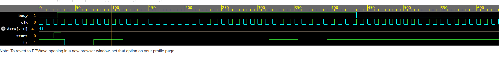
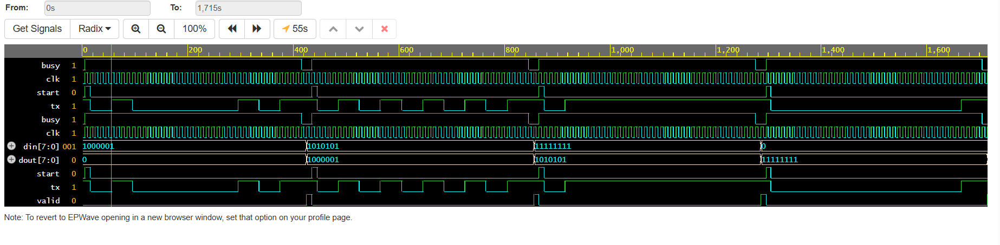

# UART TX/RX in Verilog
FSM-based UART transmitter and receiver (8N1) with a self-checking loopback testbench.

## Tools
Icarus Verilog, EDA Playground, GTKWave

## How to run
iverilog -o sim src/uart_tx.v src/uart_rx.v tb/tb_loopback.v
vvp sim

## Results
Loopback test prints PASS for all test bytes. See docs/ for waveforms.

## Next steps
Stop-bit check, FPGA implementation

## Simulation Waveforms

### UART Transmitter Waveform

### UART Transmitter and Receiver Waveform

